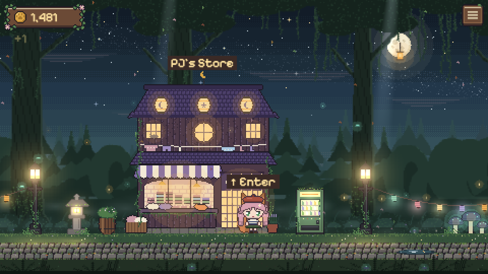
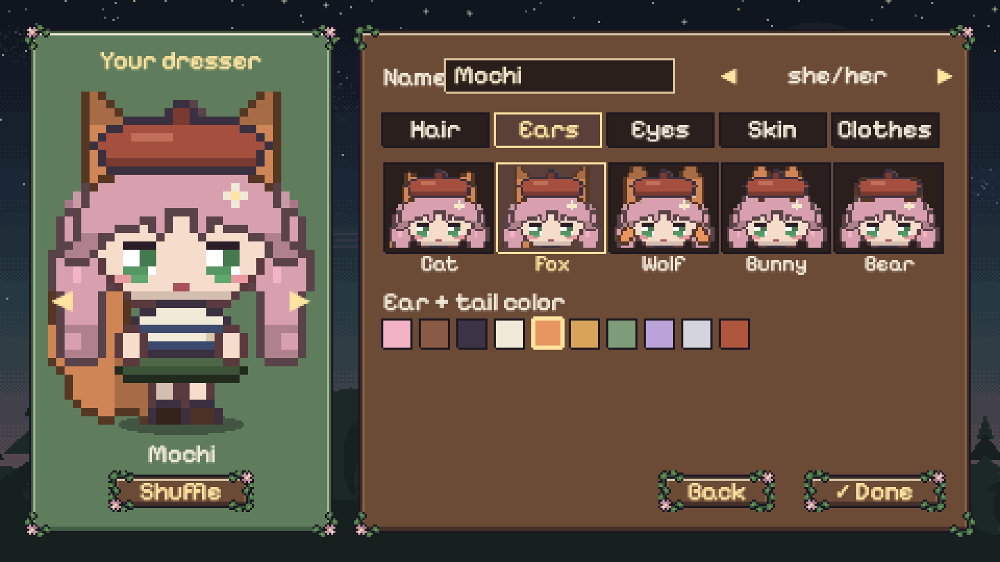
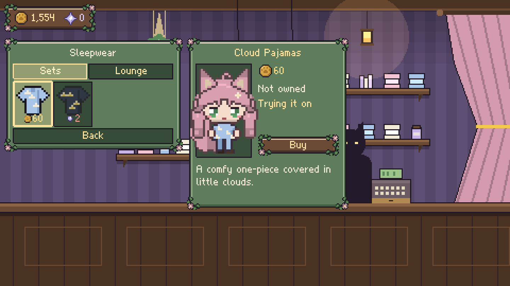
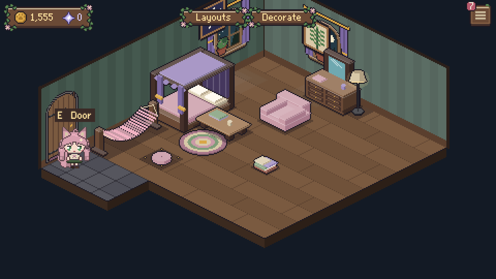
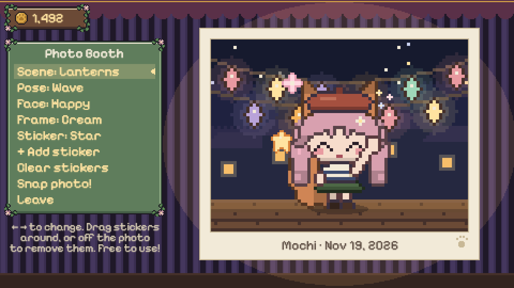

<div align="center">

# 🐾 My Cozy Market 🐾

### pixel-art forest market

Stroll a lantern-lit market street at dusk, earn coins, dress up your pal,<br>
and fill a little home with plants and furniture you picked out yourself.

**[🌲 Play it here: my-cozy-market.vercel.app 🌲]([https://my-cozy-market.vercel.app])**

<!-- 📸 SCREENSHOT: the street at dusk with your pal, shops and lanterns.
     Save it as screenshots/street.png and the line below will show it. -->


</div>

---

## 🌸 What is this?

**My Cozy Market** is a single-player, side-scrolling dress-up and decorating game that runs right in your browser.
You make a little pal with wolf, cat, fox, bunny or bear ears, then wander a night-market street in the
middle of an enchanted forest. Coins build up while you play (and a little while you're away), and you
spend them on outfits, pajamas, furniture and plants to make your cozy corner of the woods truly yours.

Accounts are invite-only, so your character and your home are saved to your account and waiting for you
whenever you log back in. 💌

---

## ✨ Features

| | |
|---|---|
| 🌙 **Side-scrolling street** | A dusk forest market with parallax layers, a big moon, moonbeams, drifting mist, fireflies, falling leaves and flickering lanterns |
| 🐺 **Character creator** | Pick a name, pronouns, hair style (8 of them!), ears and tail (wolf, cat, fox, bunny, bear), and colors for fur, eyes, skin and outfit |
| 👗 **Dresser** | Walk up to the dresser at home to restyle your pal and put on clothes you've bought |
| 🪙 **Idle coins** | Earn coins just by hanging out, plus a "welcome back" bonus for time spent away |
| 🛍️ **Shops** | Tabbed picture catalogues with item descriptions, try-on previews on your own pal, buy and sell |
| 🏡 **Isometric home** | Decorate mode with free placement: drag things anywhere, flip them, store them, and **repaint** decor in new colors. Even the door, windows and dresser can move |
| 📸 **Photo booth** | Pick a backdrop and a pose, stick on hearts and sparkles, and download a photo of your pal in an instant-camera frame |
| 📌 **Bulletin board** | Little paper notes on the street about what's coming next |
| 🎵 **Chiptune music** | Calm 8-bit tunes made live in the browser, with an on/off switch in the menu |
| 🔐 **Invite-only accounts** | Sign up with an invite code; your progress saves to the cloud |

### 🏪 The shops

| Shop | What's inside |
|---|---|
| 🌙 **PJ's Store** | Cloud and star pajamas, fuzzy socks, bunny slippers, sleep caps |
| 🪑 **Furniture** | Mushroom lamps, rocking chairs, a canopy bed, a hammock, wall prints and more |
| 🪴 **Plant Shop** | Tiny cacti, monsteras, hanging ivy, a sakura tree, a bonsai and fresh flowers |
| 👟 **Street Clothes** | Berets, flower crowns, moss hoodies, plaid skirts, rain boots and totes |
| 📸 **Photo Booth** | Free to use! Snap a picture of your pal |

<div align="center">

<!-- 📸 SCREENSHOT: the character creator. Save as screenshots/creator.png -->

<!-- 📸 SCREENSHOT: a shop catalogue with an item preview. Save as screenshots/shop.png -->


<!-- 📸 SCREENSHOT: your decorated isometric home. Save as screenshots/home.png -->

<!-- 📸 SCREENSHOT: a photo from the photo booth. Save as screenshots/photobooth.png -->


</div>

---

## 🎮 How to play

| Where | Keys | Mouse |
|---|---|---|
| 🌲 **Street** | `←` `→` or `A` `D` to walk · `↑` / `W` / `E` at a door to go in or read the board | Click a shop door or the bulletin board |
| 🛍️ **Shop** | `↑` `↓` `←` `→` to browse (and switch tabs) · `Enter` / `Space` to buy · `Esc` to go back | Click an item to preview it |
| 🏡 **Home** | Arrow keys or `WASD` to walk · `E` at the door or dresser · `B` for decorate mode | Click the door, the dresser or **Decorate** |
| 🎨 **Decorate mode** | Arrow keys to nudge · `F` to flip · `Delete` to put away · `Esc` to finish | Drag things around, click a color swatch to paint |
| 📸 **Photo booth** | `↑` `↓` to pick a row · `←` `→` to change it · `Enter` on **Snap photo!** · `Esc` to leave | Drag stickers onto the photo (drag them off to remove) |
| 🧭 **Anywhere** | `M` opens the corner menu (Home/Town, Music, Log out) | Click the button in the top right |

> 💡 Browsers only allow sound after you click or press a key, so the music starts on your first click.

---

## 🧺 Built with

| | |
|---|---|
| 🎮 [Phaser 3](https://phaser.io) | The game engine |
| ⚡ [Vite](https://vitejs.dev) | Dev server and build |
| 🗝️ [Supabase](https://supabase.com) | Invite-only login and cloud saves |
| ▲ [Vercel](https://vercel.com) | Hosting |
| 🔤 Cozy Market Pixel | Our own pixel font, drawn in `tools/art/font.js` |
| 🖌️ `tools/make-art.js` | **All the pixel art is drawn by code!** Run `npm run art` to regenerate the PNGs in `public/assets` |
| 🎶 Web Audio | The chiptune music, generated live (no audio files) |

---

## 🛠️ Run it yourself

You'll need [Node.js](https://nodejs.org) installed.

```bash
git clone https://github.com/papayawhip117/Paw-Pal.git
cd Paw-Pal
npm install
npm run dev
```

Then open the link Vite prints (usually http://localhost:5173). 🎉

### 🔑 Logins (optional)

Without any setup, the game runs in **offline guest mode**: no login, and your save lives in your browser.

To turn on accounts, copy `.env.example` to `.env` and fill in the two values from your own Supabase project
(Project Settings → API):

```
VITE_SUPABASE_URL=
VITE_SUPABASE_ANON_KEY=
```

Then run `supabase/schema.sql` in your Supabase project's SQL editor to create the tables and the invite-code check.
`.env` is in `.gitignore`, so your real values never get pushed. On Vercel, add the same two names under
Project Settings → Environment Variables.

### 📜 Scripts

| Command | What it does |
|---|---|
| `npm run dev` | Start the game locally with hot reload |
| `npm run build` | Build the site into `dist/` |
| `npm run preview` | Preview the built site |
| `npm run art` | Redraw all the pixel art into `public/assets` |
| `npm run art -- --preview` | Also save art preview sheets to `tools/preview/` |

### 🗂️ Where things live

```
src/
  scenes/   Street, Shop, Home, Creator, PhotoBooth
  objects/  your pal (Player + CharacterLook)
  ui/       menus, panels, coin counter, login screen, decorator
  world/    background, street, shop interiors, isometric room, recolor
  state/    game state, saving, Supabase, item catalogue
  audio/    the chiptune music
  data/     bulletin board notes
  config.js shops, items, prices, colors and other knobs
tools/      the art generator (npm run art)
supabase/   database schema
```

---

## 🗺️ Roadmap

- [x] Side-scrolling forest bazaar street
- [x] Idle coins + welcome-back bonus
- [x] Enterable shops with tabbed catalogues
- [x] Character creator with wolf, cat, fox, bunny and bear ears
- [x] Invite-only accounts with cloud saves
- [x] Isometric home with free placement and recolorable decor
- [x] Chiptune music and a pixel font
- [x] Photo booth
- [ ] 🐾 Pets that follow your pal around town
- [ ] ☕ A cozy cafe mini-game
- [ ] 🧸 More outfits, comfy furniture and rare plants
- [ ] 🛋️ Proper isometric sprites for home decor
- [ ] 🎨 An art polish pass

---

<div align="center">

made with 💚 and a lot of tiny pixels

🍄 🌙 🐾 🌙 🍄

</div>
